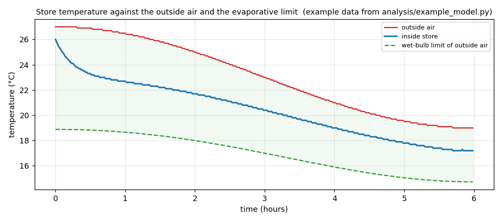
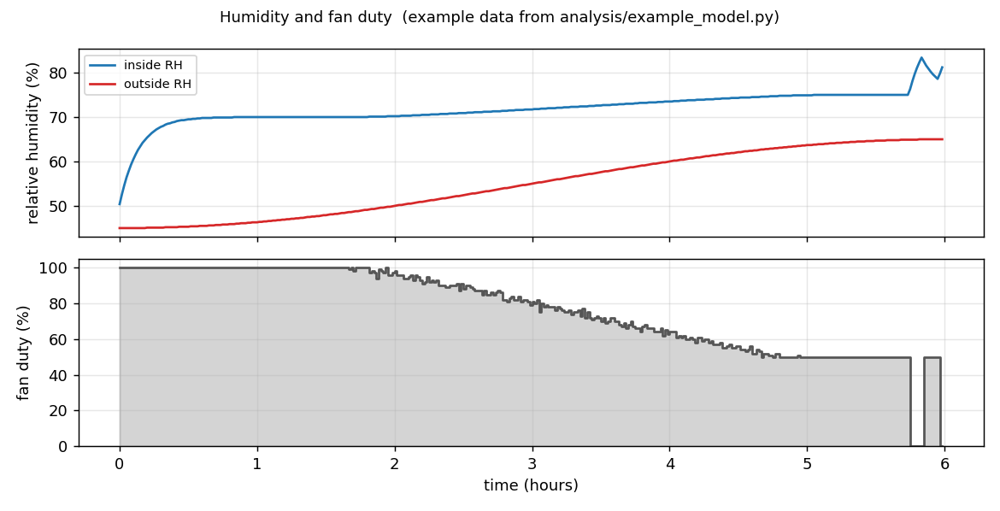

# HydroCool: a low-power food store that cools itself

A second-year group project at Manchester Metropolitan University: an insulated food store that keeps produce cool without a compressor. Water from a header tank trickles down cloth lining the inside walls, and a small extract fan draws air through the damp cloth so evaporation cools it. A Raspberry Pi Pico W reads temperature and humidity inside and out, runs the fan only when it will help, and logs everything to its own flash.

I did the CAD, electronics and programming; a teammate on the mechanical side handled the thermal simulations. This repository holds the controller firmware, the logging format and the scripts used to analyse a log.



## What it does

- **Measures** inside and outside temperature and relative humidity with two DHT22 sensors every 10 s, and watches a float switch in the header tank.
- **Decides when the fan is worth running.** Evaporative cooling can never take air below its wet-bulb temperature, so the controller computes that limit from the outside reading and backs the fan off when the store is already close to it. It also purges the store when the inside air becomes too humid for evaporation to continue.
- **Scales the fan** with how far the store is above target, between half and full speed, with hysteresis so it does not chatter.
- **Logs one CSV row a minute** to the Pico's flash: both sensors, the wet-bulb limit, fan duty, water-low flag and the controller's reason. Each power cycle starts a new session number because the Pico has no clock.
- **Signals water low** with a fast LED blink.

`analysis/plot_log.py` turns a log copied off the Pico into the two plots in this README and prints the average temperature drop, the saturation efficiency and the fan's duty cycle.

## Hardware

| Part | Notes |
|---|---|
| Raspberry Pi Pico W | MicroPython; logs to its own flash |
| 2 x DHT22 | Inside (GP15) and outside (GP16) temperature and humidity |
| Float switch | Header tank low-water, GP17 with pull-up |
| 12 V 80 mm fan + logic-level MOSFET | PWM at 25 kHz on GP20, mounted to pull air out of the store |
| Header tank and drip bar | Gravity feed onto cotton cloth lining the walls |
| Insulated box | Polystyrene-lined enclosure, 3D-printed brackets and drip bar |

Power: 12 V supply for the fan, 5 V for the Pico. Fan consumption is around 2.4 W at full speed, so a six-hour run is roughly 10 Wh.

## Software

- Firmware: MicroPython 1.22 or newer on the Pico W, using the built-in `dht` module.
- Analysis: Python 3.10 or newer with `matplotlib`.

```
firmware/
  main.py          read, control, log, repeat
  controller.py    fan decision logic (no hardware imports, testable on a PC)
  wetbulb.py       wet-bulb, dew-point and efficiency formulas (shared with analysis)
  sensors.py       DHT22 reads with retry, float switch
  fan.py           PWM fan driver
  logger.py        CSV logging with session numbers and a size limit
  config.py        pins, target temperature, thresholds
analysis/
  plot_log.py      plots and summary for a log file
  example_model.py produces data/example_log.csv from a simple thermal model
data/
  example_log.csv  model output used for the plots in this README (not a measurement)
docs/              images for this README
```

## How to run

**On the Pico**

1. Flash MicroPython to the Pico W and copy every file in `firmware/` to it (Thonny: *File > Save as > Raspberry Pi Pico*).
2. Power up. `main.py` starts automatically and prints a status line every 10 s over USB serial.
3. To get the data back, open `log.csv` from the Pico in Thonny and save it to your computer.

Pins and thresholds are in `firmware/config.py`.

**Plotting a log**

```bash
git clone https://github.com/siamct/hydrocool-evaporative-cooler.git
cd hydrocool-evaporative-cooler/analysis
pip install -r requirements.txt
python plot_log.py path/to/log.csv        # or no argument for the example data
```

## Results

The plots in this README come from `analysis/example_model.py`, a lumped thermal model driven by the real controller logic over a warm afternoon that cools into the evening. They are there to show what the analysis produces, not as measurements. In the example the store settles 2 to 3 °C below the outside air with a saturation efficiency of about 40 %, which is in the range expected for a cloth-lined box rather than a commercial cooling pad.



Two things stand out even in the model. First, the wet-bulb line is the real limit: on a humid British day it sits only a few degrees below the air temperature, so an evaporative store is a cool larder, not a fridge. Second, airflow is only useful while the inside air is drier than saturated, which is why the controller purges on humidity as well as cooling on temperature.

## What I learned

- **Start from the physics limit.** Computing the wet-bulb temperature on the Pico gave the controller a reason to stop running the fan when it could not help, which saved water and power compared to simple thermostat control.
- **Hysteresis everywhere.** Both the temperature and humidity rules needed on and off thresholds; without them the fan switched several times a minute.
- **DHT22s are slow and flaky.** They need two seconds between reads and fail a checksum now and then. Retrying and keeping the last good value was essential; so was not reading them faster than the datasheet allows.
- **Logging to flash needs a budget.** The Pico W has under a megabyte free, so the logger stops at a size limit instead of filling the file system and breaking the firmware.
- **Separate the decision from the hardware.** Keeping `controller.py` free of `machine` imports meant the same code could drive the example model on a laptop.

## Licence

MIT. See [LICENSE](LICENSE).
